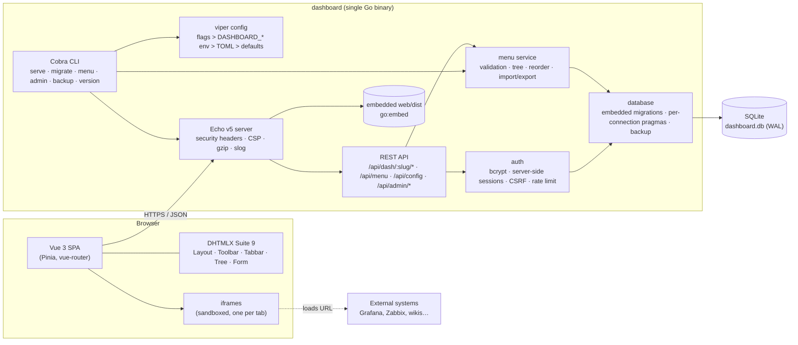
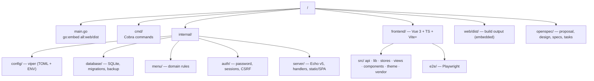
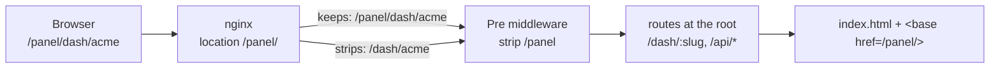
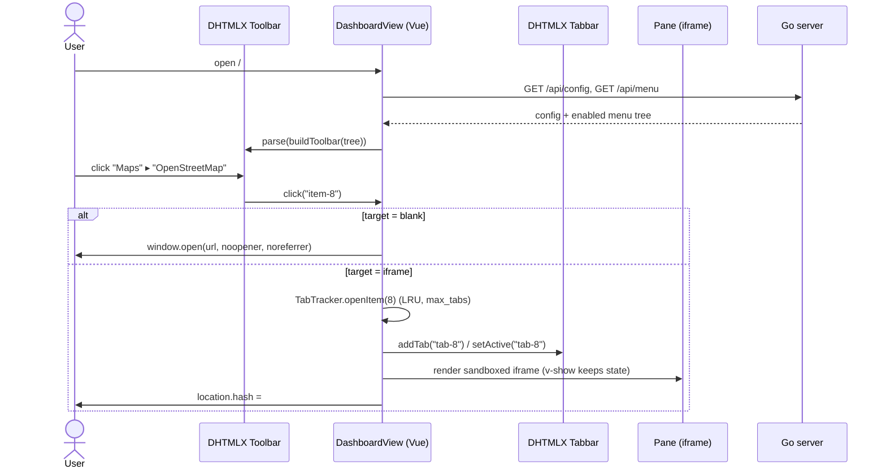
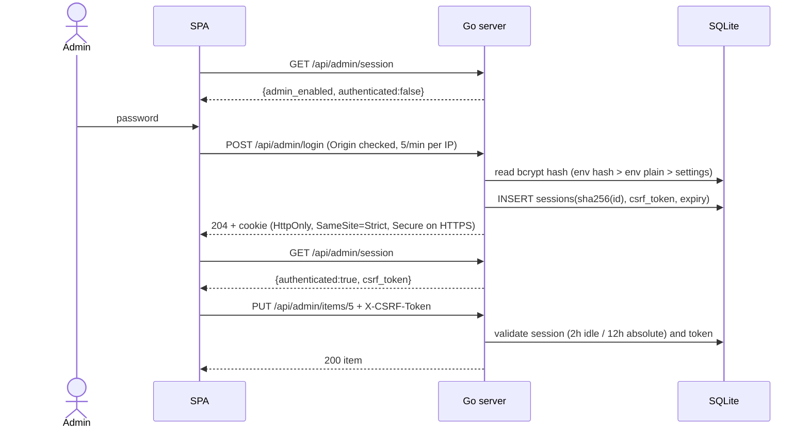
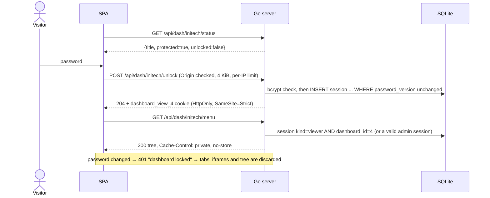
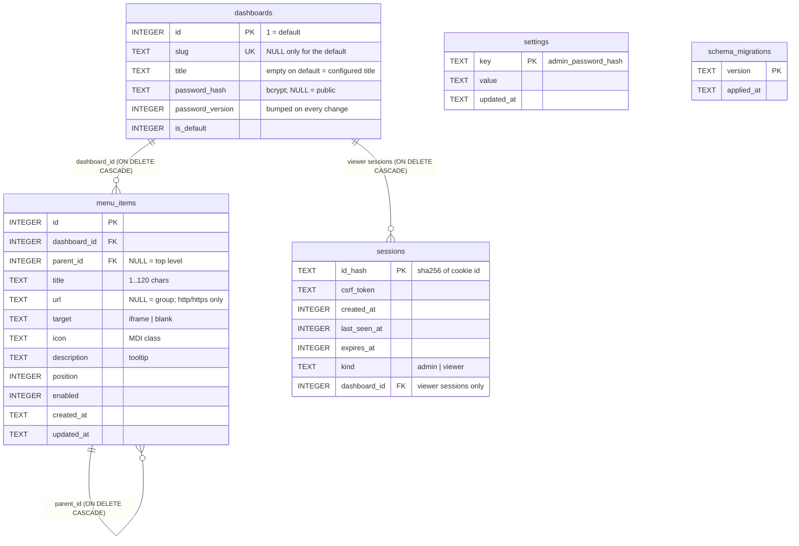
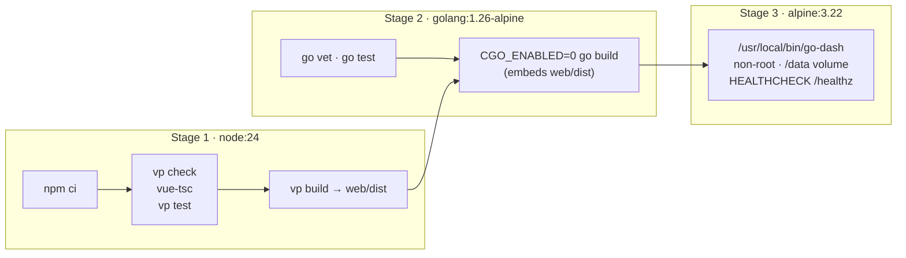

# Architecture

The dashboard is a single Go binary that serves a Vue 3 single-page app and a
JSON API, stores menu items in SQLite and embeds the whole frontend build.

## Components

## Repository layout

## Serving under a sub-path

With `base_path = "/panel/"` the server accepts both `/panel/api/menu`
(proxy keeps the prefix) and `/api/menu` (proxy strips it): an `e.Pre`
middleware removes the prefix on a segment boundary before routing. Every URL
it emits carries the prefix: `index.html` gets `<base href="/panel/">`
(always injected, also for `/`), redirects use `/panel/...` and cookies have
`Path=/panel/`. The frontend is built once with relative asset URLs and reads
the base from the `<base>` element (`src/lib/basePath.ts`) for the router
history, API calls and `localStorage` keys.

## Request flow: opening a link in a tab

## Admin authentication

## Dashboards and viewer sessions

The default dashboard (id 1, no slug) is served at `/`; named dashboards at
`/dash/<slug>`. The SPA asks `GET /api/dash/:slug/status` first (`default` is
the API sentinel for `/`) and shows the unlock screen, "Dashboard not
found" or the dashboard. Viewer sessions live in `sessions` with
`kind = 'viewer'` and a `dashboard_id`; the cookie is `dashboard_view_<id>`.

Admin routes are scoped by dashboard: `/api/admin/dashboards/:dashboardID/items…`
(`:dashboardID` is numeric or `default`); the old `/api/admin/items`,
`/export` and `/import` act on the default dashboard.

## Data model

## Build and deployment

## Key decisions

| Decision | Why |
| --- | --- |
| `modernc.org/sqlite` (pure Go) | `CGO_ENABLED=0`, static binary, trivial cross-compile. |
| Pragmas in the DSN | `database/sql` pools connections; DSN pragmas apply to every connection. |
| Server-side sessions | Revocable on logout/password change; no signing secret to manage. |
| One viewer cookie per dashboard (by id) | Scoped revocation, survives slug renames, a viewer token is never an admin token. |
| `password_version` on unlock | A session verified with an old password can never be stored after a change. |
| Migration 0003 rebuilds `menu_items` | SQLite cannot add a `REFERENCES` column with a non-NULL default; the runner disables foreign keys only for that file and restores them before the connection returns to the pool. |
| Tabbar with `noContent` + Vue panes | Iframes are never re-created on tab switch, so each system keeps its state. |
| DHTMLX icons vendored | `suite.min.css` imports them from a CDN; the app must work offline under a `'self'` CSP. |
| Tailwind without preflight | Utilities for our own screens without resetting DHTMLX styles. |
| Themes as data (registry) | 12 themes, each flat or 3D, applied as CSS variables; adding a theme is one file, and a test enforces WCAG AAA contrast for all of them. |
| `--ui-scale` breakpoints | Same proportions on Full HD, QHD and 4K; JS-sized DHTMLX parts read the scale from CSS. |
| Inter bundled | Ocean themes typeface without external font requests. |
